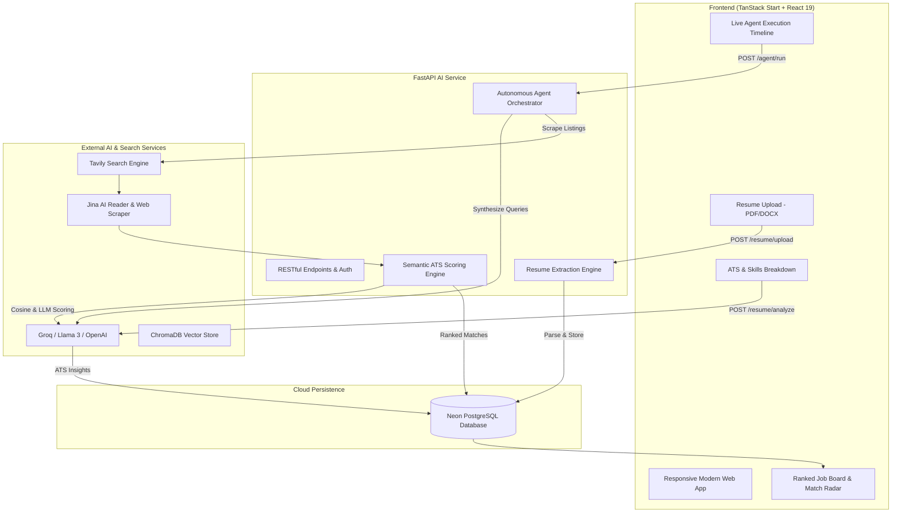

# JobScout AI — Autonomous Career Agent & ATS Intelligence Platform

[](https://www.python.org/)
[](https://fastapi.tiangolo.com/)
[](https://react.dev/)
[](https://www.typescriptlang.org/)
[](https://tailwindcss.com/)
[](https://neon.tech/)
[](https://groq.com/)

> **JobScout AI** is an autonomous full-stack AI career platform designed to bridge the gap between job seekers and recruiter ATS systems. It ingests resumes (PDF/DOCX), evaluates them against industry ATS criteria, synthesizes targeted web search queries, autonomously scours live job openings across the web using AI web-readers, and scores opportunities using multidimensional semantic matching.

---

##  Key Features

- ** Autonomous Multi-Step Agent:**
  - **Query Generation:** Deconstructs candidate strengths and generates precision search queries tailored to seniority and skills.
  - **Live Web Hunting:** Discovers and scrapes active job listings via Jina AI Reader and search engines.
  - **Deep Semantic Matching:** Analyzes job descriptions against candidate profiles to calculate weighted ATS match scores.
- ** Recruiter-Grade Resume Analysis:**
  - Real-time ATS compatibility scoring (0–100%).
  - Technical and soft skills taxonomy extraction.
  - Granular strengths, weaknesses, and actionable career improvement suggestions.
- ** Multidimensional Job Scoring:**
  - Breakdown by **Skills Match**, **Experience Fit**, and **Role Alignment**.
  - Visual Matched vs. Missing skills tags to optimize candidate applications.
- ** Real-Time Execution Tracking:**
  - Live timeline showing step-by-step progress, duration, search query logs, and partial-success safeguards.
- ** 100% Responsive Modern Interface:**
  - Fluid layouts tailored for Mobile, Tablet, and Desktop displays with slide-over drawers, touch targets, and safe-area notch support.

---

## 🏗️ Architecture & Workflow



---

## 🛠️ Technology Stack

| Layer | Technologies |
|---|---|
| **Frontend** | React 19, TanStack Start (SSR), TanStack Router & Query, TypeScript, Tailwind CSS v4, Lucide Icons, Sonner |
| **Backend** | Python 3.11+, FastAPI, SQLModel (SQLAlchemy ORM), Pydantic v2, PyPDF, python-docx |
| **AI & NLP** | Groq API (Llama 3.3 / GPT-OSS), ChromaDB vector embeddings, Jina Reader API, Tavily Search API |
| **Database & Auth** | Neon Cloud PostgreSQL, JWT (JSON Web Tokens), Passlib (Bcrypt) |

---

## 🚀 Getting Started

### 1. Prerequisites
- Python 3.11+
- Node.js 18+ & npm
- PostgreSQL connection string (e.g. Neon, Supabase, or Local PostgreSQL)

### 2. Backend Setup
```powershell
cd backend

# Create and activate virtual environment
python -m venv .venv
.venv\Scripts\activate   # On Windows
# source .venv/bin/activate  # On Linux/macOS

# Install dependencies
pip install -r requirements.txt

# Configure environment variables (.env)
cp .env.example .env
# Edit .env with your DATABASE_URL and API keys (Groq, Tavily, Jina)

# Run server
uvicorn app.main:app --reload --port 8000
```
Backend API docs available at: `http://127.0.0.1:8000/docs`

### 3. Frontend Setup
```powershell
cd frontend

# Install dependencies
npm install

# Run development server
npm run dev
```
Frontend application accessible at: `http://localhost:8080` (or `http://localhost:5173`)

---

## 🧪 Quick Demo Login

For portfolio reviewers and recruiters testing the live deployment:
- **Email:** `demo@jobscout.ai`
- **Password:** `Demo12345!`
- *(Includes preloaded candidate profile, ATS resume audit, and 70+ scored live job matches).*

---

## 📄 License
This project is licensed under the MIT License.
